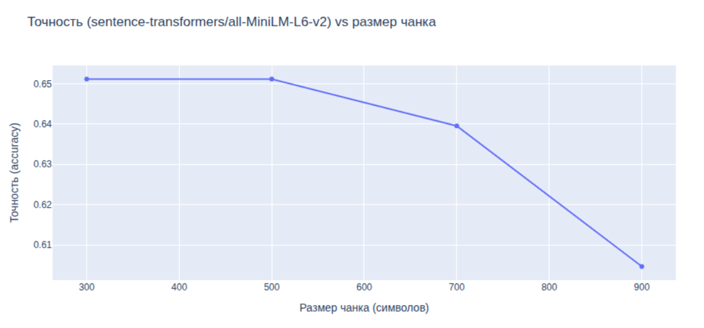
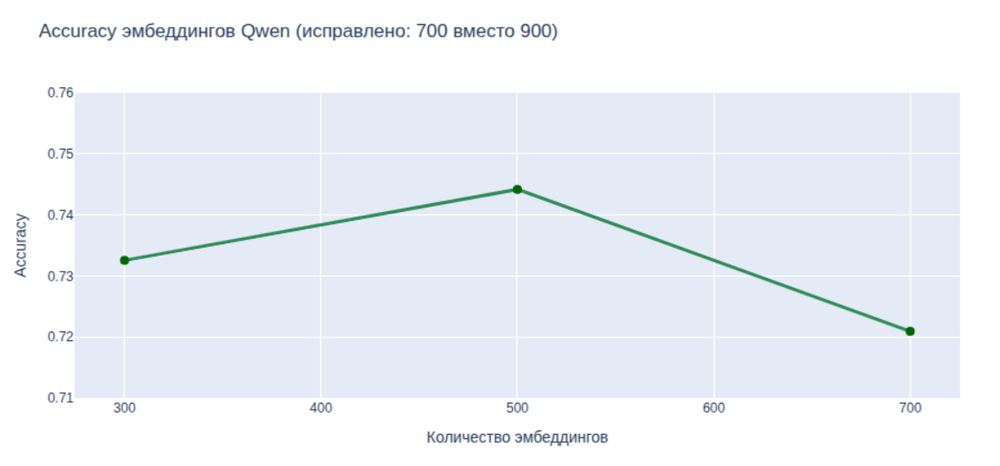
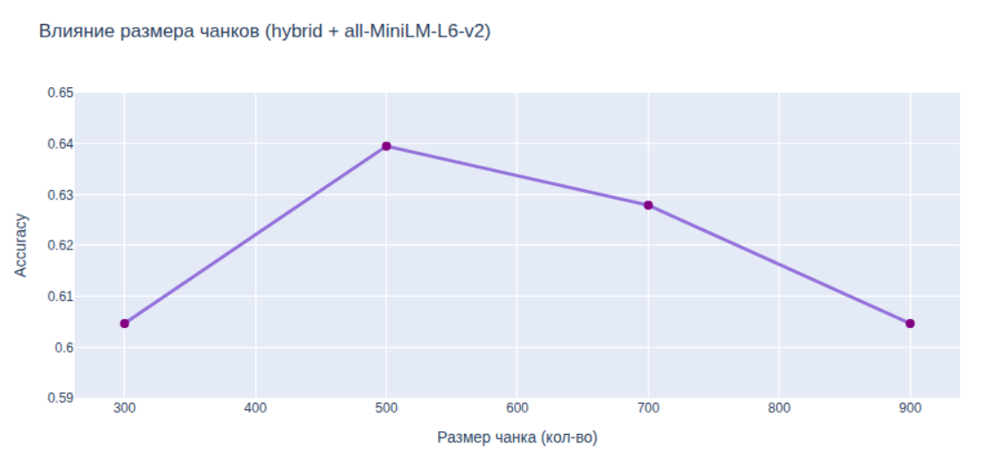
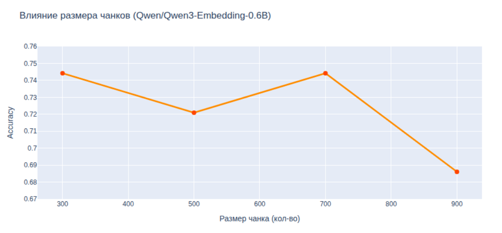
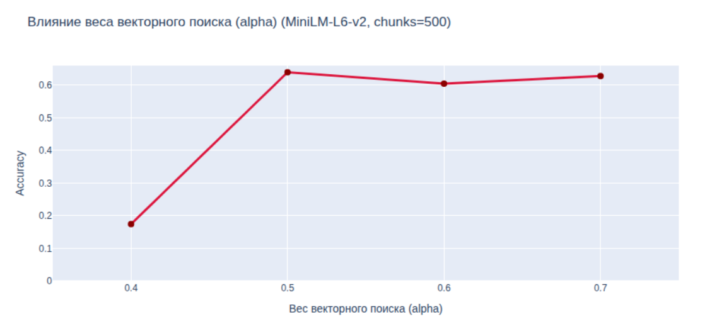
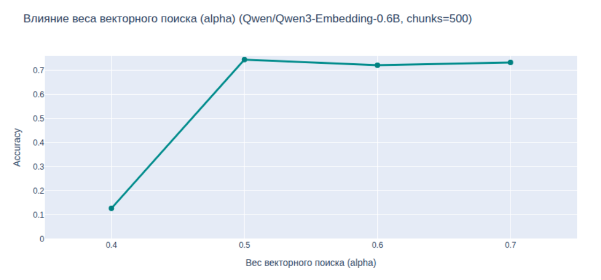
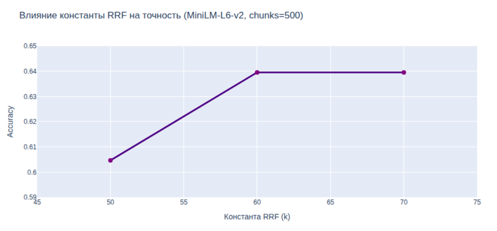
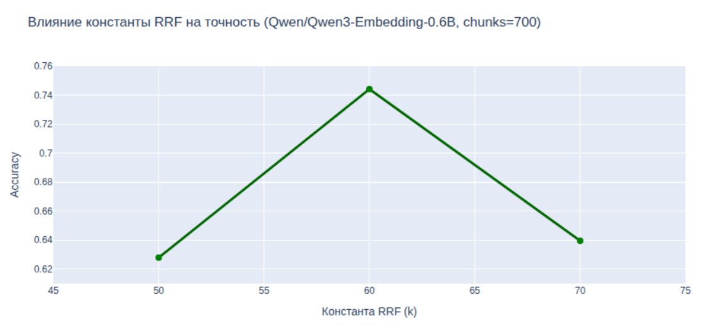

# Отчет по улучшению RAG

## 1. Используемые техники улучшения RAG

<u>Техника 1.</u> Выделение метаданных из базы-знаний и организация поиска по векторной базе с фильтрами.

Сравнивались два варианта:

1.  Контекст для создания векторной базы формируется путем простого соединения всех полей базы знаний. Поля разбиваются на чанки. Осуществляется простой поиск по запросу в векторной базе и топ-5 результатов передаются в контекст для ответа на вопрос LLM.
2.  Из полей developer, project, class, district, metro, dist_to_metro, num_residents, shcool_plan, shcool_fact, nursery_plan, nursery_fact, parking таблицы выделяются метаданные для фильтров векторной базы. Поле cleaned_description таблицы descriptions используется для формирования чанков. Из запроса пользователя сначала выделяется фильтр для поиска в векторной базе данных (через LLM-экстрактор).

**Результат:**
*   точность первого варианта — 0,023
*   точность второго варианта — 0,651

Далее во всех экспериментах используется второй вариант с выделением фильтров.

<u>Техника 2.</u> Промпт-инжиниринг.

Использование промтов на трех этапах: выделение фильтров, основной запрос, расчет метрик. 
*Пример:* изменение системного промпта для добавления рассуждений (Chain of Thought) позволило исправить неверный ответ о вместимости школ в проектах «Ильинские луга» и «Восточное Бутово».

<u>Техники 3 и 4.</u> Выбор размера чанка и модели эмбеддингов.

*   **all-MiniLM-L6-v2:** Рост точности с 0.605 до 0.651 при уменьшении чанков с 900 до 500. Предел насыщения на 500.
    
*   **Qwen3-Embedding-0.6B:** Лучший результат при Chunksize = 500 с точностью **0.744**. Значительно превосходит MiniLM.
    
<u>Техника 5.</u> Использование Context Expansion (иерархические чанки Parent/Child).

*   Child Chunks = 200, Parent Chunks = 1000.
*   **Результат:** точность accuracy составила 0.71264. Прироста не дало из-за малого размера исходного контекста, но техника полезна для больших документов.

<u>Техника 6.</u> Гибридный поиск (BM25 + Векторы + RRF).
*   **Влияние размера чанков при использовании all-MiniLM-L6-v2:**
    
*   **Влияние размера чанков при использовании Qwen3-Embedding-0.6B:**
    
*   **Влияние веса векторного поиска weight_vect при разбиении на чанки равном 500 и использовании all-MiniLM-L6-v2:**
    
*   **Влияние веса векторного поиска weight_vect при разбиении на чанки равном 700 и использовании Qwen3-Embedding-0.6B:**
    
*   **Влияние константы RRF при разбиении на чанки равном 500, weight_vect=0.5 и использовании all-MiniLM-L6-v2:**
    
*   **Влияние константы RRF при разбиении на чанки равном 500, weight_vect=0.5 и использовании Qwen3-Embedding-0.6B:**
    

Оптимальные параметры: вес векторного поиска 0.5, константа RRF = 60, разбиение на чанки 500-700.
Эмбеддинги Qwen3-Embedding-0.6B в среднем показывают точность на 10% выше, чем all-MiniLM-L6-v2.

<u>Техника 7.</u> Лемматизация на входе BM25.

Для русского языка лемматизация обязательна.
*   **MiniLM (500 чанков):** с 63.95% до **79.07%** (+15.12%).
*   **Qwen3 (700 чанков):** с 74.42% до **84.88%** (+10.46%).

<u>Техника 8.</u> Использование разных LLM.

*   GigaChat-2-Lite — 0.8488
*   GigaChat-2-Pro — 0.8488
*   GigaChat-3-Lightning — 0.616279

**Вывод:** Оптимально использовать GigaChat-2.

---

## 2. Итоговая лучшая конфигурация

1.  Извлечение фильтров из метаданных.
2.  Итоговый набор промптов с жестким JSON-форматом.
3.  Модель эмбеддингов: **Qwen3-Embedding-0.6B**.
4.  Размер чанка: **700**, перекрытие: **50**.
5.  Гибридный поиск: RRF с весами 0.5 (вектор) / 0.5 (BM25), константа k=60.
6.  Лемматизация для BM25.
7.  LLM для генерации: **GigaChat-2**.

**Итоговая точность (Accuracy) на валидационном наборе: 0.8488.**

## 3. Анализ качества найденных чанков

Сравнение базовой техники (только векторный поиск) и итогового пайплайна (гибридный поиск + лемма + фильтры):

| Метрика | Базовая техника | Итоговый пайплайн | Разница |
| :--- | :--- | :--- | :--- |
| **Общая точность (Accuracy)** | 65.12% (56/86) | **84.88% (73/86)** | **+19.76%** |
| Уникальные правильные ответы (где база была права) | 1 случай | — | — |
| Уникальные правильные ответы (где итог был прав) | — | **18 случаев** | Пайплайн исправил 18 ошибок |
| Совместно правильные | 55 | 55 | — |
| Совместно неправильные | 12 | 12 | «Слепые зоны» |

**Примеры улучшения:**
*   *(Вопрос ID 8):* Base искал по смыслу «вместимость школ» и нашел ЖК «ДЖОЙС». Best через BM25 нашел лемму «ярославский» и ответил верно (2700 мест).
*   *(Вопрос ID 18):* Base выдал ЖК «Барклая 6». Best нашел метаданные ЖК «Зеленый парк» и число 1100.

*Единственный пример ухудшения (ID 56):* BM25 дал высокий вес точному совпадению «Химки парк» и вытеснил из топ-K чанк со словом «Мира», из-за чего LLM ответила, что данных нет.

## 4. Результаты экспериментов

*(В исходном документе здесь приведена большая таблица с 41 экспериментом, варьирующими weight_vect, const_rrf, model, chunks, emb, pipeline, with_lema).*

**Ключевые выводы из таблицы results.csv:**
*   Лучший результат (0.8488) получен в `exp_22` и `exp_35`: pipeline=gibrid, emb=qwen, chunks=700, with_lema=True, weight_vect=0.5, const_rrf=60.
*   Худший результат (0.12-0.17) при weight_vect = 0.4 (семантический сигнал подавлен).
*   Отключение лемматизации (with_lema=False) стабильно роняет точность на 10-15%.

## 5. Суммарные выводы по всем техникам

1.  **Гибридный поиск** значительно превосходит базовый векторный (0.85 против 0.74). Разрыв > 10%.
2.  **Лемматизация** — самый мощный рычаг роста. Все топ-5 результатов получены с ней.
3.  **Эмбеддинги:** Qwen значительно эффективнее MiniLM в базовом пайплайне.
4.  **Размер чанков:** для гибридного поиска оптимален диапазон 500–700.
5.  **Вес векторного поиска:** оптимум 0.5–0.7.
